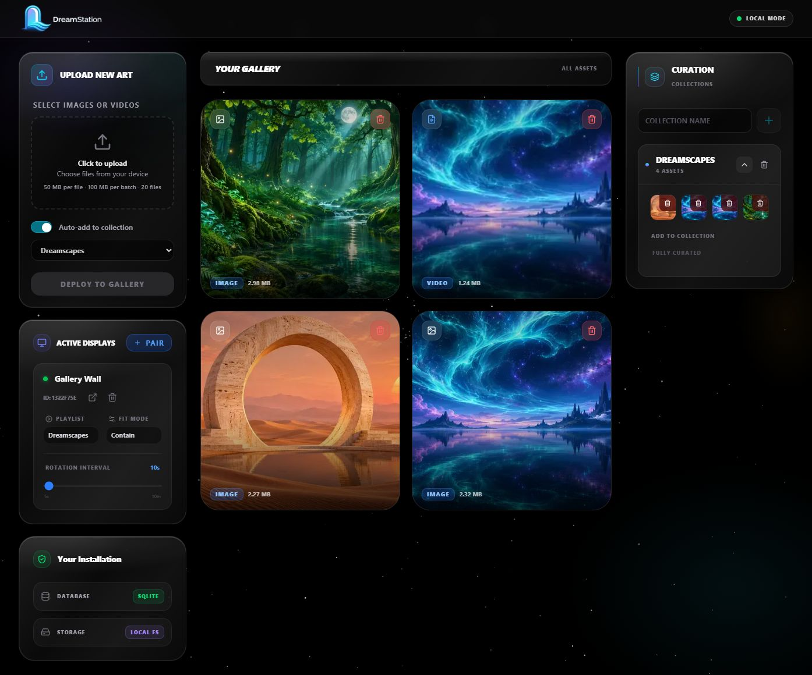
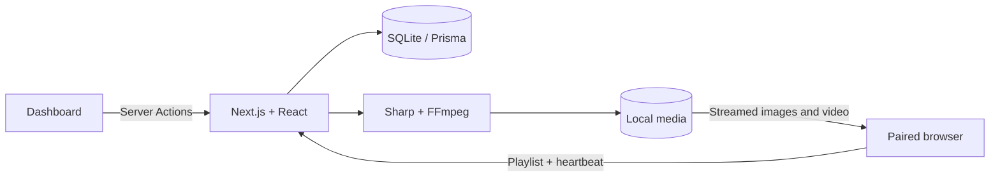
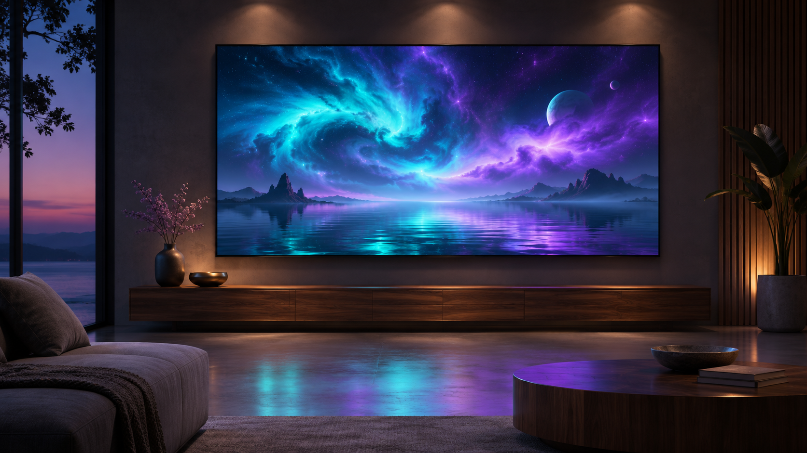

# DreamStation Frame

**Your art. Every screen. Entirely local.**

Turn a spare monitor, tablet, or browser-equipped TV into a digital art display. Upload images and short videos, curate collections, and pair screens from one self-hosted dashboard. No cloud account or subscription is required to run DreamStation.



[Watch the short demo](docs/media/dreamstation-demo.mp4) · [Installation and deployment](docs/DEPLOYMENT.md) · [Architecture](docs/ARCHITECTURE.md)

## What it does

- **Mixed-media collections:** JPG, PNG, WebP, MP4 and WebM; automatic image previews and video thumbnails.
- **Pair any browser:** enter a six-digit code or scan a QR code. Codes expire after ten minutes and work once.
- **Independent displays:** choose a collection, contain/cover fit, and a 5-second to 10-minute rotation interval per screen.
- **Immersive playback:** image/video crossfades, muted looping video, shuffle, fullscreen and keyboard navigation.
- **Local storage:** SQLite metadata and ordinary files, with a responsive dashboard and online/offline display status.

> **For trusted home and studio networks.** There is no login or access control. Anyone who can reach the server can view, upload, change or delete its contents. Keep it on your trusted LAN; do not port-forward it or expose it directly to the internet. Pairing identifies a screen; it is not an authentication boundary.

## Quick start

Use **Node.js 24 LTS** and npm. Node.js 22.12+ is also supported. Installation needs internet access to download packages and platform-specific SQLite, Sharp and FFmpeg binaries. The running app stores your media locally.

```bash
git clone https://github.com/llmxlabs/dreamstation.git
cd dreamstation
npm ci
```

Copy the example environment file:

```bash
# macOS / Linux
cp .env.example .env
```

```powershell
# Windows PowerShell
Copy-Item .env.example .env
```

Then initialize the database, build and start:

```bash
npm run db:setup
npm run build
npm start -- --hostname 127.0.0.1
```

Open [localhost:3000](http://localhost:3000). `npm ci` generates the Prisma client. `db:setup` creates the SQLite file, applies the schema and seeds the local profile; it does not replace an existing profile.

To connect other devices, stop the server and start it on your trusted LAN:

```bash
npm start -- --hostname 0.0.0.0 --port 3000
```

Open `http://YOUR-LAN-IP:3000` from the dashboard device and display devices. Allow the port only on your private network. A TV must have a browser capable of playing the chosen media codec. This is a persistent Node.js application, not a static site or serverless deployment.

## Your first collection

1. Upload your artwork, or try the original samples in [`examples/media`](examples/media).
2. Enter a collection name in **Curation** and press **+**. Expand the collection and select images/videos to add them. Enable **Auto-add to collection** to send subsequent uploads there automatically.
3. Click **Pair** under **Active Displays**. On your screen, open `/pair`, enter the code and give the screen a name. A QR code can prefill the code.
4. Assign the collection to the new display. Choose **Contain** to show the whole artwork or **Cover** to fill the screen. Set the rotation interval.
5. Bookmark the player URL. Use its fullscreen control, left/right arrow keys or Space to advance. Shuffle can be toggled in the player.

Changes and heartbeats are polled every 30 seconds. Displays become offline after 90 seconds without a heartbeat. Videos are muted and loop within the configured slide interval; the interval can cut a longer video short. Browser fullscreen requires a click. Keep the server and screen awake for continuous playback.

Limits: **50 MiB per file, 100 MiB per batch, 20 files per upload**, and images up to 40 megapixels. Use H.264 MP4 for broad device compatibility. Files are validated and decoded on the server; an invalid batch is rolled back.


## How it works



One Node.js process serves the dashboard, pairing and player. Prisma stores collections and screen settings in SQLite. Sharp generates image previews; bundled FFmpeg decodes video thumbnails. A streaming route supports video byte ranges and new uploads without restarting the server. See the [architecture guide](docs/ARCHITECTURE.md) for the data model, lifecycle and limits.

| Path | Purpose |
| --- | --- |
| `src/app` | Dashboard, pairing, player and media routes |
| `src/actions` | Validated uploads, collection and display operations |
| `src/components` | Dashboard controls and visual components |
| `src/lib` | SQLite client and media processing |
| `prisma` | Schema and idempotent local-profile seed |
| `tests` | Isolated SQLite and media regression tests |
| `examples/media` | Original demo images and an eight-second sample clip |
| `docs` | Deployment, architecture, security records and demo media |

## Configuration and maintenance

`DATABASE_URL` defaults to `file:./prisma/dev.db`. Paths are relative to the project directory. `NEXT_PUBLIC_APP_URL` optionally sets the LAN base URL for pairing QR codes; set it **before building**. Otherwise QR codes use the address of the dashboard you opened. Use `--port` on the start command to choose another port.

Back up the SQLite file, `public/uploads/` and your private `.env` with the server stopped. None of these personal files belongs in Git. Detailed [backup, restore and troubleshooting instructions](docs/DEPLOYMENT.md) cover Windows, Linux and macOS. SQLite is the supported database; PostgreSQL requires a code and schema migration.

## Development and checks

```bash
npm run dev -- --hostname 127.0.0.1
npm run lint
npm run typecheck
npm test
npm run build
npm audit --audit-level=high
```

Tests create disposable databases and media in temporary directories. CI checks a fresh installation, database setup, lint, tests, production build, type checking and dependency audit. Contributions should include regression coverage for behavior changes. Do not commit databases, uploads, credentials or raw security reports.

## Security Issues

The release review resolved dependency, upload-handling, setup and lifecycle findings. See the [security review hub](docs/security/README.md), [issue record](docs/security/SECURITY-ISSUES.md) and [scan history](docs/security/SCAN-HISTORY.md). Scanner results describe the reviewed scope, not a guarantee that no vulnerabilities exist. Report sensitive issues using the process in [SECURITY.md](SECURITY.md).

## Artwork and license

Code is licensed under [MIT](LICENSE). The included sample artwork was generated specifically for this project; see [media provenance](docs/MEDIA.md). The image below is an AI-generated concept illustration, not a photograph of supplied hardware. DreamStation is software; bring your own screen.


