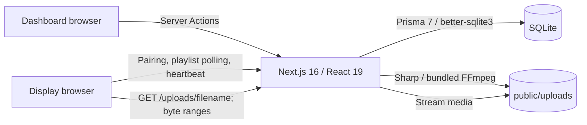

# Architecture

DreamStation Frame is a single-user application for a trusted home or studio LAN. One persistent Node.js process serves the dashboard, display pairing page, slideshow players, and uploaded media. The server stores metadata in SQLite and media on its local filesystem.

## Components

| Area | Implementation |
| --- | --- |
| Dashboard | React components in `src/components`, composed by `src/app/page.tsx` |
| Mutations and queries | Next.js Server Actions in `src/actions` |
| Persistence | Prisma 7 generated client and `@prisma/adapter-better-sqlite3` in `src/lib/prisma.ts` |
| Media processing | `src/lib/storage.ts`, Sharp for images and the platform binary supplied by `ffmpeg-static` for video thumbnails |
| Media delivery | Dynamic Node.js route at `src/app/uploads/[filename]/route.ts`, shared through `/api/media/[filename]`; a before-filesystem rewrite makes existing and new uploads use the same range validation |
| Pairing | `src/app/pair/page.tsx` and display actions |
| Slideshow | `src/app/player/[displayId]/page.tsx` |

The UI uses Tailwind CSS, Framer Motion, and Lucide icons. Prisma's generated client is created by the `postinstall` script; generated files, dependency directories, and builds are not release source.

## Data model

`User` is a fixed local profile created by the seed command, not a login account. `Asset` records point to the original file and generated previews. A `Playlist` contains ordered `PlaylistItem` records, each referencing an asset. Each `Display` can have one assigned playlist and stores its own fit mode and rotation interval. `PairingCode` records expire after ten minutes. `Heartbeat` retains the latest observation for a display.

Pairing consumes a code and creates a display in one database transaction. Collection changes and dependent-record deletion are transactional. Adding an asset already present in a collection is idempotent. Display configuration updates merge partial changes, so changing fit mode does not reset the rotation interval.

## Upload lifecycle

Uploads accept JPEG, PNG, WebP, MP4, and WebM. The server enforces up to 20 files per batch, 50 MiB per file, and 100 MiB total. Image decoding is limited to 40 million pixels. These checks run on the server as well as any UI guidance.

Files receive generated UUID filenames; client filenames never become storage paths. Sharp checks and decodes image contents, applies orientation, and creates a WebP display image bounded by 1920 × 1920 pixels plus a 400 × 400 thumbnail. The original is retained. Videos are checked for their container signature and decoded by FFmpeg to produce a thumbnail, with a 30-second processing timeout. Videos are **not transcoded**: the player streams the original, so the display browser must support its codec.

Media preparation precedes the asset-record transaction. Failed preparation or a failed database write triggers cleanup of files created for that upload. Deleting an asset removes database references first, then attempts physical file cleanup; a filesystem failure can leave an unused file requiring administrator cleanup.

## Playback and connectivity

The player requests its playlist and sends a heartbeat every 30 seconds. Configuration changes therefore propagate on the next poll. The dashboard considers a display online only when its latest heartbeat is less than 90 seconds old. This reports recent contact with the server, not a hardware power measurement.

Images and muted looping videos rotate at the selected 5–600 second interval. Shuffle is enabled initially and can be toggled in the player. The current slide and neighboring slides are rendered to limit resource use. A temporary failed playlist request keeps the last successfully loaded playlist; this is not a full offline cache, and unavailable media may still fail to load.

The dynamic media route serves files added after a production build. It supports `GET`, `HEAD`, and one HTTP byte range, including partial responses used for video seeking. Invalid ranges return `416`; missing or invalid paths return `404`. Responses restrict MIME types and include `nosniff`. Files are read in chunks rather than loading an entire video into server memory for every request.

## Trust and deployment boundary

There is no authentication or user isolation. Anyone who can reach the server can manage the gallery and displays and access media. Pairing is a convenience for creating a display record, not an authentication boundary. Use a trusted LAN and restrict host firewall access accordingly. Do not expose this release directly to the public internet or forward its port through your router.

This architecture requires a long-running Node.js server with writable persistent storage. Static hosting, ephemeral serverless filesystems, multiple application replicas, and PostgreSQL are not supported deployment configurations. Keep the database and `public/uploads` together when backing up or moving the application. See [deployment and operations](DEPLOYMENT.md).
